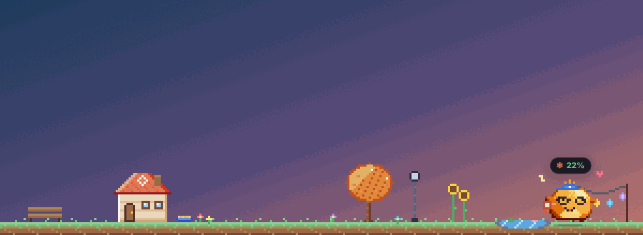
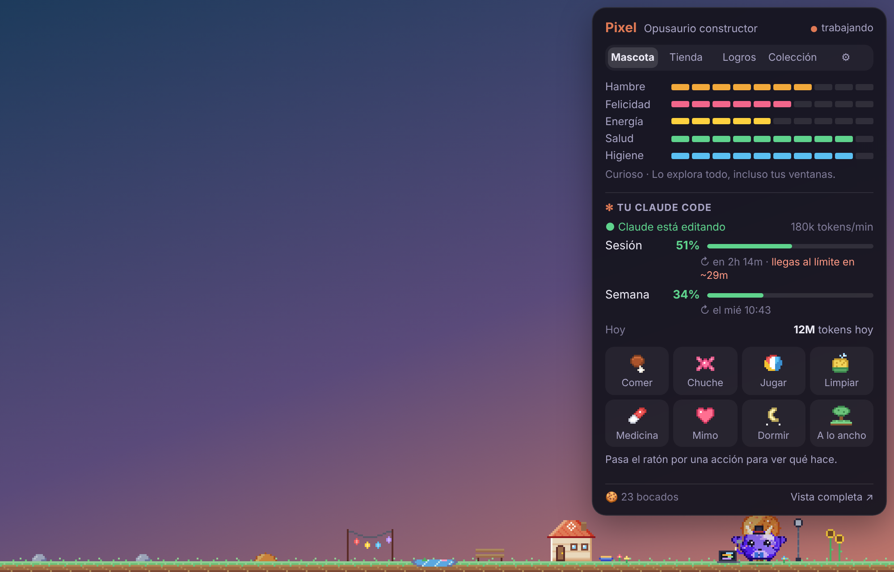
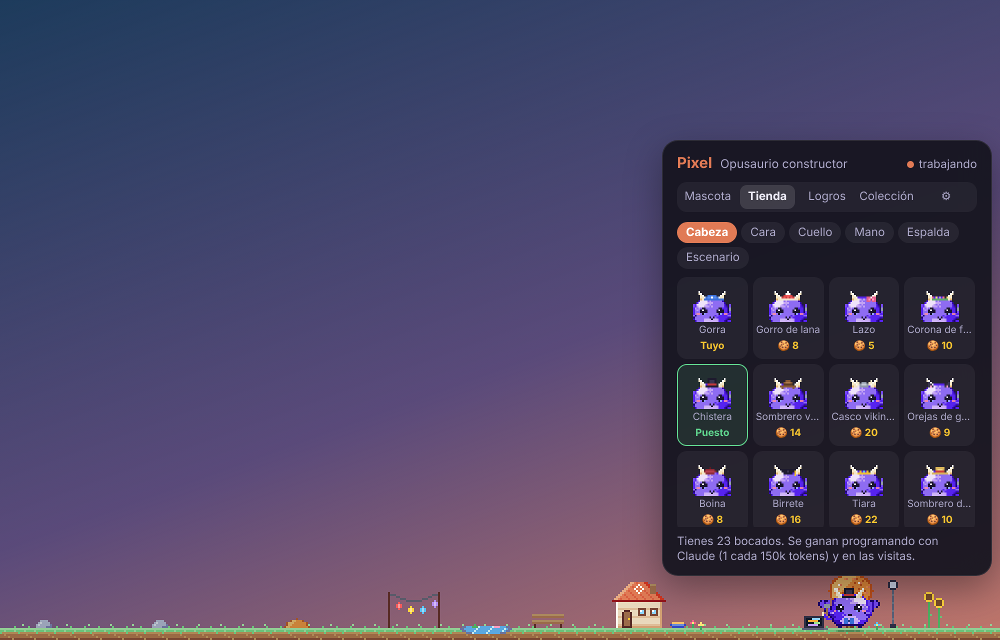
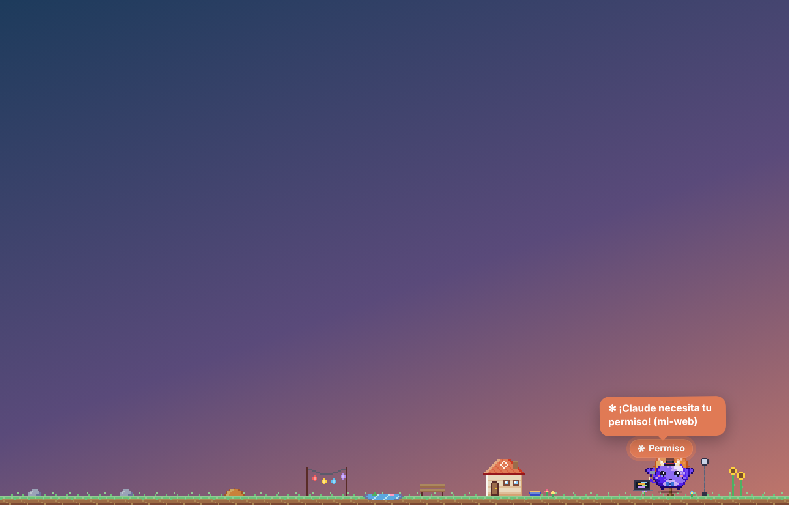

# Claudagotchi

*[Leer en castellano](README.md)*

**A pixel-art desktop pet that lives on your Claude Code usage.** It walks on top of your taskbar, eats the tokens you spend with Claude, shows your real session and weekly limits, and makes noise when Claude needs you.



> The interface is in Spanish for now. Everything is ready for translations (`src/i18n/`), and English is next.

## Install

**Windows**: download [Claudagotchi-windows-x64-setup.exe](https://github.com/CarlosDarko/claudagotchi/releases/latest/download/Claudagotchi-windows-x64-setup.exe) and open it. Or, without the SmartScreen warning, in PowerShell:

```powershell
irm https://raw.githubusercontent.com/CarlosDarko/claudagotchi/main/install.ps1 | iex
```

**macOS and Linux**:

```bash
curl -fsSL https://raw.githubusercontent.com/CarlosDarko/claudagotchi/main/install.sh | bash
```

**Or just ask Claude Code** to do it:

```text
Install Claudagotchi following https://raw.githubusercontent.com/CarlosDarko/claudagotchi/main/INSTALAR.md
```

No Node needed. It starts with your computer, and updates itself with one click.

## What it does

- **Lives on your desktop, out of the way.** A transparent, always-on-top window over the taskbar. Clicks go through it except on the pet itself. It hides when something goes full screen.
- **Eats what you do with Claude.** Every time Claude Code spends tokens, orange ✻ sparks fall and it eats them. Your tokens are its food.
- **Shows your real usage.** Session (5 h) and weekly %, when they reset, and whether you'll hit the limit at your current pace. With your limits connected, its energy *is* what's left of your session.
- **Tells you when Claude needs you**, with sound, jumping, a pulsing badge and a system notification: when Claude needs permission, is waiting for you, has finished, or you're running low on tokens. It uses Claude Code's official hooks.
- **Reacts to your code.** It cheers for commits and green tests, and gets sad when they fail.
- **A real Tamagotchi.** Hunger, happiness, energy, health and hygiene, poop to clean, sickness and medicine, a mini game, naps in its house, butterflies, visitors and gifts on special dates. A personality of its own (sleepy, greedy, playful, vain, calm, curious, cuddly or naughty).
- **Grows with the way you use Claude.** Egg → baby → kid → teen → adult → legend. Its species comes from the model you use most (Opus, Sonnet, Haiku, Fable), its job from the tools Claude uses with you (builder, explorer, hacker, sage, conductor). 30 adult forms plus 5 secret ones to collect.
- **A shop**: 49 accessories and 25 decorations for its scene, bought with treats you earn by coding.
- **Real weather** from your city and the seasons in its scene. If it rains, it takes out an umbrella.
- **41 achievements**, a collection, 8-bit sounds and a shareable card.



| | |
|---|---|
|  |  |

It also lives in Claude Code's status line and in your terminal (`claudagotchi`), as the same pet.

## Privacy

No telemetry and no servers of its own. Everything stays on your machine in `~/.claudagotchi/`. It only connects to Anthropic (your usage %), GitHub (update checks) and Open-Meteo (weather, only if you set a city), and each one can be turned off in the ⚙ tab. Full policy: [`docs/privacidad.md`](docs/privacidad.md).

## Code signing policy

Free code signing provided by SignPath.io, certificate by SignPath Foundation. Policy and team: [`docs/firma.md`](docs/firma.md). Installers are built only by GitHub Actions from this repository.

## Development

```bash
npm test
```

```bash
node bin/claudagotchi.js demo
```

Architecture: [`docs/arquitectura.md`](docs/arquitectura.md). Made with Node/Bun and Tauri (Rust). All the pixel art is drawn in code.

## License

MIT.
