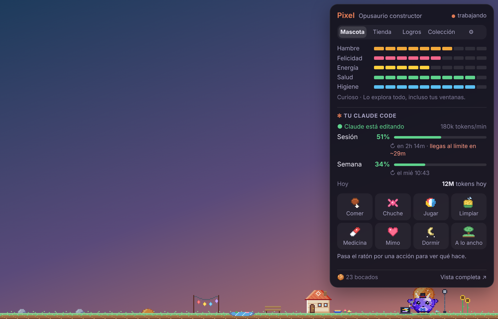
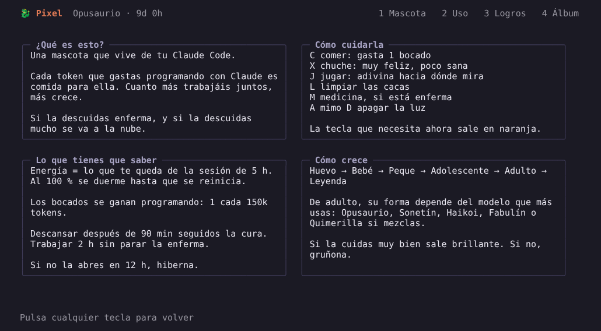
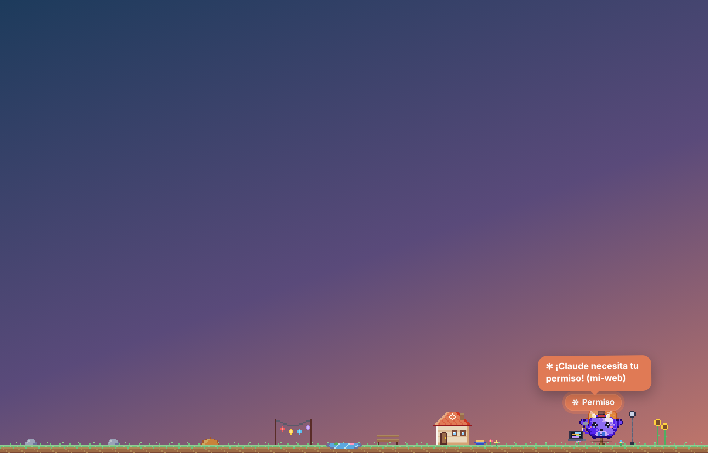
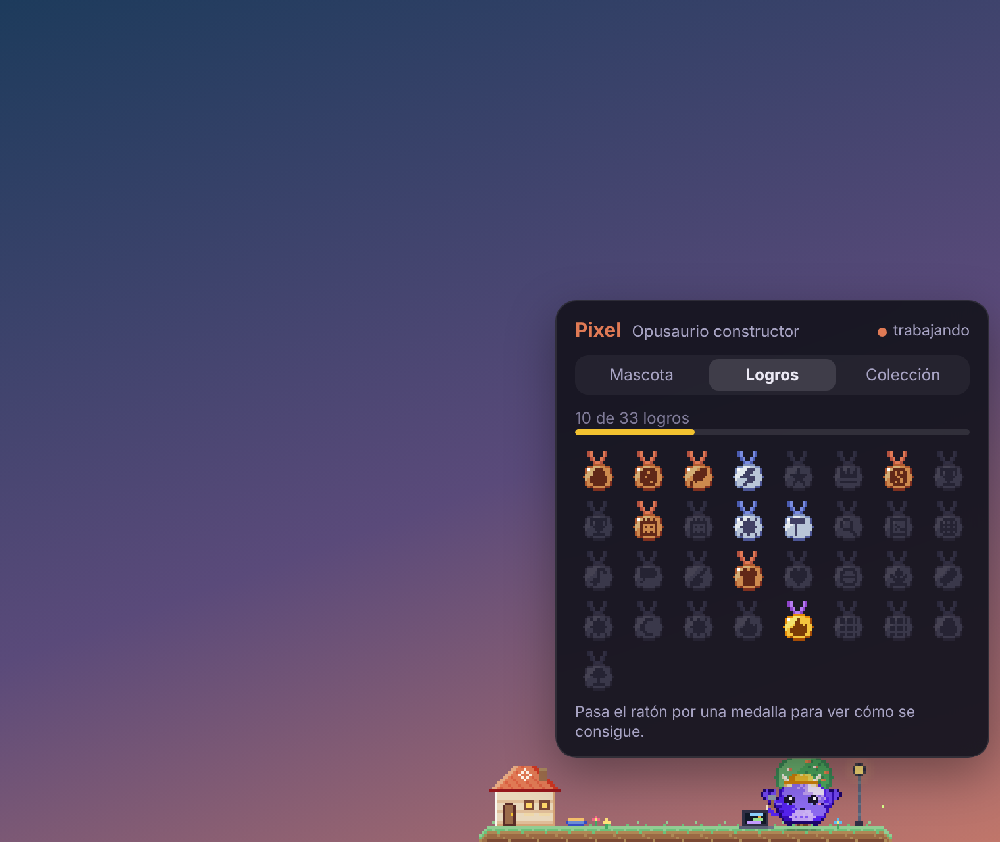
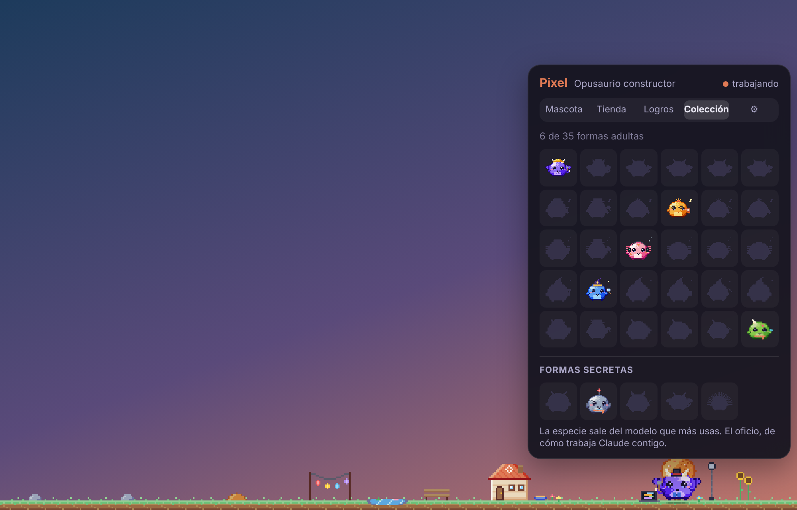
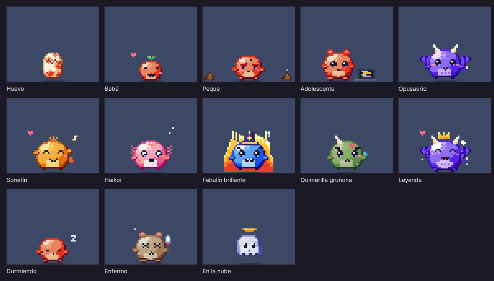
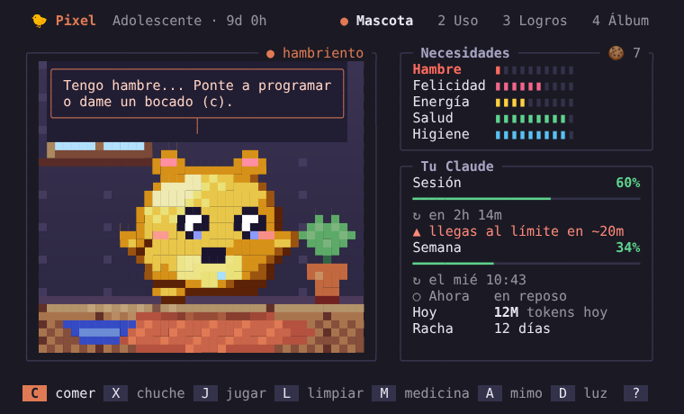
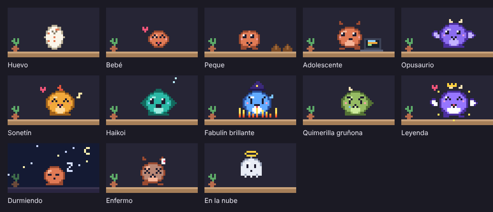
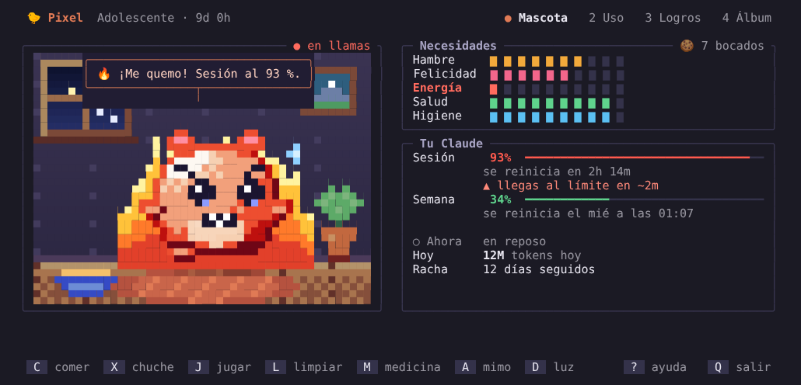
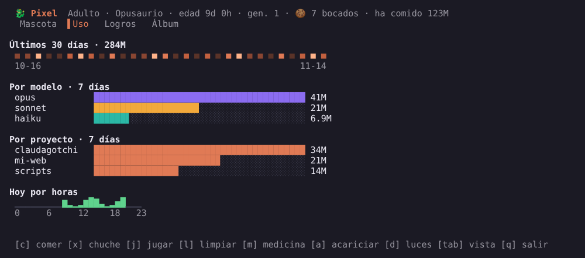

# Claudagotchi

Una mascota tipo tamagotchi que vive **en tu escritorio**, en la barra de estado de Claude Code y en tu terminal, y que **se alimenta de tu uso real de Claude**. Cuanto más programas, más come y más crece. Si te pasas, se quema. Si llegas al límite de la sesión, se duerme hasta que se reinicia. Y si llevas horas sin parar, te pide que descanses (y se cura cuando lo haces).



## Instalarlo

### En Windows: descarga y doble clic

1. Descarga **[Claudagotchi-windows-x64-setup.exe](https://github.com/CarlosDarko/claudagotchi/releases/latest/download/Claudagotchi-windows-x64-setup.exe)**.
2. Ábrelo con doble clic. Si Windows avisa con 'Windows protegió tu PC', pulsa **Más información → Ejecutar de todas formas** (pasa con cualquier programa nuevo sin firma de pago).
3. Al terminar se abre sola y queda puesta para **arrancar con el ordenador**. Para verla también en la barra de Claude Code, actívalo en su icono junto al reloj: **Mostrar en Claude Code**.

### La forma más fácil si usas Claude Code: pídeselo

Abre Claude Code y pega esta frase:

```text
Instala Claudagotchi siguiendo https://raw.githubusercontent.com/CarlosDarko/claudagotchi/main/INSTALAR.md
```

Claude Code te cuenta qué va a cambiar, lo instala, comprueba que funciona y te explica cómo usarlo. No hace falta saber nada de terminales ni tener Node.

### Con una línea en la terminal

En **macOS o Linux**, abre la app Terminal y pega:

```bash
curl -fsSL https://raw.githubusercontent.com/CarlosDarko/claudagotchi/main/install.sh | bash
```

En **Windows**, abre PowerShell y pega:

```powershell
irm https://raw.githubusercontent.com/CarlosDarko/claudagotchi/main/install.ps1 | iex
```

Las dos descargan el programa ya preparado para tu sistema (no necesitan Node), ponen la mascota en tu escritorio y en la barra de Claude Code, y la arrancan. Si no quieres la mascota de escritorio, añade `CLAUDAGOTCHI_SIN_WIDGET=1` delante del comando.

Después, cuando quieras verla en grande, abre una terminal y escribe `claudagotchi`. Para ver todo lo que puede hacer sin esperar semanas, `claudagotchi demo`. Para actualizar, `claudagotchi actualizar`.

### Si ya tienes Node

```bash
npx github:CarlosDarko/claudagotchi
```



## Qué es

Mezcla dos cosas que ya existían por separado:

- **Un monitor de uso de Claude Code**: el % real de tu sesión de 5 horas y de tu semana, cuándo se reinician, a qué ritmo gastas y si llegarás al reinicio, tokens por día, modelo y proyecto, y un gráfico de 30 días.
- **Un tamagotchi de verdad**: con hambre, felicidad, energía, salud e higiene, cacas que limpiar, enfermedades, evolución en seis etapas, cinco formas adultas, logros, minijuego y, si lo descuidas, una nube a la que se va.

La gracia está en que las dos cosas están conectadas: tus tokens son su comida, el % de tu sesión es su energía y tus descansos son su salud.

### En tu escritorio, sin molestar

La mascota vive encima de la barra de tareas, en su escenario a lo ancho de la pantalla, como en los juegos de escritorio tipo Tiny Pasture. Es una ventana transparente y siempre encima, pero **los clics la atraviesan** salvo justo encima de ella, así que puedes seguir trabajando como si no estuviera.

- **Te avisa de lo que pasa en Claude Code**, con sonido, saltos, la pastilla parpadeando en naranja y notificación del sistema:
  - cuando **Claude necesita tu permiso** (insiste hasta que respondes),
  - cuando **te está esperando** o **ha terminado**,
  - cuando **te quedan pocos tokens** en la sesión.
  Funciona con los hooks oficiales de Claude Code, que se activan solos (y se quitan en ⚙ o en el menú).
- **Se come lo que haces con Claude**: cada vez que Claude Code gasta tokens, le caen chispas ✻ y se las come.
- **Reacciona a tu código**: celebra los commits y los tests en verde, y se pone triste si fallan.
- **Tiene vida propia**: pasea, lee, riega su árbol, persigue mariposas, se echa la siesta dentro de su casa, te saluda si acercas el ratón y, si es curiosa, **se sube a la ventana que estés usando**. Si pones algo a pantalla completa (un vídeo, un juego), se esconde.
- **Personalidad**: dormilona, glotona, juguetona, presumida, tranquila, curiosa, mimosa o traviesa. Cambia sus frases, sus necesidades y lo que hace.
- **Visitas y fechas especiales**: un pajarito que trae bocados, el gato del vecino, el cartero con un regalo, la tortuga sabia… Y en Navidad, Halloween, San Valentín y cada cumplemés, regalos.
- **El tiempo real de tu ciudad** (lluvia, nieve, tormenta) y **las estaciones** en el escenario. Si llueve, saca el paraguas.
- **Sonidos de 8 bits** para cada acción y reacción (se apagan en ⚙ o en el menú).
- **Su tarjeta**, al pasar el ratón, con cinco pestañas:
  - **Mascota**: sus necesidades, tu Claude Code y los botones para cuidarla.
  - **Tienda**: **49 accesorios** (sombreros, gafas, collares, cosas en la mano, capas y alas) y **25 decoraciones** para el escenario, que se compran con bocados.
  - **Logros**: 41 medallas.
  - **Colección**: 30 formas adultas y 5 secretas.
  - **⚙ Ajustes**: su **nombre**, tu ciudad, escenario (a lo ancho, isla o ninguno), tamaño, sonidos, avisos, **compartir su ficha** (una imagen para redes) y actualizar.
- **Se actualiza sola**: cuando sale una versión nueva aparece un botón en su tarjeta y se instala con un clic.

| | |
|---|---|
|  |  |
|  |  |



### En la terminal

`claudagotchi` abre la vista completa: su habitación (con una ventana que enseña el cielo de tu hora real), sus necesidades, tu uso detallado, sus logros y su álbum.


### Pensado para que se entienda solo

- **Lo que necesita, resaltado.** Cuando tiene hambre, está sucio o enfermo, te lo dice en su bocadillo y la tecla que lo arregla se pone en naranja.
- **Medidores como los de un tamagotchi**, sin números que interpretar: cada necesidad tiene su color y solo se pone en rojo cuando hay que hacer algo.
- **Se adapta a tu terminal.** Desde 80×24 (el tamaño por defecto de casi todas) hasta pantalla completa, donde la mascota se dibuja al doble de tamaño.



## Comandos

| Comando | Qué hace |
|---|---|
| `claudagotchi` | Abre la mascota (interfaz animada a pantalla completa) |
| `claudagotchi instalar` | La pone en la statusline de Claude Code |
| `claudagotchi desinstalar` | La quita y devuelve la statusline que tuvieras |
| `claudagotchi estado` | Resumen en una línea, el mismo de la statusline |
| `claudagotchi nombre Turrón` | Le cambia el nombre |
| `claudagotchi nuevo [nombre]` | Adopta un huevo nuevo (la actual se jubila al álbum) |
| `claudagotchi idioma es` | Cambia el idioma |
| `claudagotchi actualizar` | Descarga la última versión (tu mascota no se toca) |
| `claudagotchi diagnostico` | Explica por qué se ve (o no) tu % real |
| `claudagotchi conectar` | Conecta tu cuenta de Claude para ver el % real |
| `claudagotchi ciudad Madrid` | Pone el tiempo real de tu ciudad en el escenario |
| `claudagotchi avisos` / `avisos no` | Activa o quita los avisos de Claude Code |
| `claudagotchi demo` | Todas las etapas y humores con datos de mentira, sin tocar nada tuyo |
| `claudagotchi foto [ancho] [alto]` | Imprime un fotograma de la interfaz (útil para compartir) |

### Teclas

| Tecla | Acción |
|---|---|
| `c` | Comer (gasta 1 bocado, +25 de saciedad) |
| `x` | Chuche (gasta 1 bocado, mucha felicidad, quita algo de salud) |
| `j` | Jugar: adivina con ← → hacia dónde mirará, 5 rondas |
| `l` | Limpiar las cacas |
| `m` | Medicina (cura, con 2 horas de espera entre tomas) |
| `a` | Acariciar |
| `d` | Apagar o encender la luz (dormido gasta la mitad) |
| `tab` o `1`–`4` | Mascota · Uso · Logros · Álbum |
| `?` | Ayuda |
| `h` | Adoptar un huevo nuevo cuando se ha ido a la nube |
| `q` | Salir |

## Cómo funciona el juego

Todo esto está también dentro de la mascota: en la pestaña **?** de su tarjeta, y al pasar el ratón por cada necesidad.

| Necesidad | Baja con | Sube con |
|---|---|---|
| 🍖 **Hambre** | 4 puntos por hora | Tus tokens: cada 40k tokens nuevos es 1 punto. También los bocados |
| ⚡ **Energía** | Con tu cuenta conectada (ves el %): es lo que te queda de la sesión de 5 h, así que baja según gastas | Se llena cuando la sesión se reinicia. Sin cuenta conectada: baja mientras Claude trabaja y sube cuando para, y mucho más rápido con **Dormir** |
| 💖 **Felicidad** | 2,5 por hora | Jugar, acariciar, chuches, programar con él al lado, días seguidos |
| 🧼 **Higiene** | Las cacas (una cada 1,5M tokens o cada 8 h despierto) | Limpiar |
| 🩺 **Salud** | Hambre o suciedad extremas, la semana por encima del 90 %, más de 2 h trabajando sin parar | Todo en orden, medicina, y los descansos después de un tramo largo |

- **Bocados**: la moneda para darle de comer a mano. Ganas 1 cada 150k tokens, 2 al día por saludar y empiezas con 5.
- **Humores**: feliz, tranquilo, trabajando (con su portátil), hambriento, sucio, triste, cansado, enfermo, en llamas (sesión al 90 %), durmiendo (luz apagada o sesión al 100 %) y en la nube.
- **Hiberna**: si nadie lo mira en más de 12 horas, deja de gastar. No se te muere un fin de semana.
- **En la nube**: si su salud llega a 0 se va. Queda en el **Álbum** y puedes adoptar otro huevo, que hereda tus logros.

### Evolución



| Etapa | Cuándo |
|---|---|
| 🥚 Huevo | Al empezar. Se va agrietando mientras usas Claude y eclosiona cuando ha comido 250k tokens (o a las 2 horas) |
| 🐣 Bebé | Recién nacido |
| 🐥 Peque | 2M tokens y 12 horas de vida |
| 🐤 Adolescente | 15M tokens y 2 días |
| Adulto | 60M tokens y 5 días |
| 👑 Leyenda | 400M tokens, 3 semanas y un cuidado de diez |

Las crías salen cada una de un color. La **forma adulta** sale de **cómo usas Claude**: la especie, del modelo con el que más programas, y el oficio, de las herramientas que más usa Claude contigo mientras crece. 5 especies por 6 oficios son **30 formas adultas** para coleccionar.

| Forma | Dieta |
|---|---|
| 🐉 Opusaurio | Sobre todo Opus. Cuernos, alas y aire de jefe |
| 🐦 Sonetín | Sobre todo Sonnet. Cresta de pluma y notas musicales |
| 🐟 Haikoi | Sobre todo Haiku. Aletas y burbujas |
| 🧙 Fabulín | Sobre todo Fable. Sombrero de mago |
| 🦄 Quimerilla | Dieta variada. Un cuerno y una aleta |

| Oficio | Si Claude sobre todo... | Lleva |
|---|---|---|
| Constructor | edita y escribe código | casco y martillo |
| Explorador | lee y busca por el proyecto | sombrero y lupa |
| Hacker | lanza comandos en la terminal | auriculares |
| Sabio | busca en la web | gafas y libro |
| Director | delega en subagentes | pajarita y batuta |
| Equilibrado | hace un poco de todo | bufanda |

Hay además **5 formas secretas** con condiciones raras: el **Búho nocturno**, el **Robotín**, el **Michi**, el **Dragón dorado** y el **Arcoíris**. En la colección salen como silueta con una pista.

Y la **variante depende de cómo lo hayas cuidado**: **brillante** si casi siempre estuvo bien atendido, **gruñón** si no, normal en medio. Si programas sobre todo de madrugada, sale **nocturno**, con estrellitas.

### Lo que dice

Habla solo cuando pasa algo: cuando nace o evoluciona, al saludarte cada día (con lo que comió ayer y vuestra racha), cuando se acerca o llega al límite, cuando la ventana se reinicia, cuando tiene hambre o está sucio o enfermo, cuando llevas 90 minutos seguidos (y te da las gracias cuando descansas) y cuando ganas un logro. En la statusline aparece como una segunda línea durante un minuto y medio.



## El uso real



| Dato | De dónde sale |
|---|---|
| % de la sesión de 5 h y de la semana, y cuándo se reinician | De tu cuenta de Claude: primero del campo `rate_limits` que Claude Code pasa a la statusline, y si no, de la API de uso con el login que Claude Code ya tiene guardado |
| Tokens, comida, modelos, proyectos, horas y mapa de 30 días | De los logs locales de Claude Code, `~/.claude/projects/**/*.jsonl`, leídos de forma incremental |
| Si está trabajando y en qué (leyendo, editando, ejecutando…) | De la última actividad y la última herramienta en esos logs |
| Proyección (`llegas al límite en ~35m`) | Del ritmo de tokens de los últimos 20 minutos, convertido a % con la proporción de tu sesión |

- **Tokens** cuenta todo, incluida la caché. **Comida** cuenta solo los tokens nuevos (entrada, salida y escritura de caché): la lectura de caché es casi gratis y no alimenta.
- **Usa el login que Claude Code ya tiene** (en `~/.claude/.credentials.json`, o en el Llavero en macOS). Si no lo encuentra (por ejemplo, si usas Claude Code desde la app de escritorio), la tarjeta enseña el botón **Conectar mi cuenta de Claude**: abre la página oficial de Claude, aceptas y pegas el código. El token se guarda solo en tu equipo, en `~/.claudagotchi/auth.json`.
- **Una lectura vieja nunca se convierte en 0 %**: si la ventana ya pasó y no hay dato nuevo, lo dice.

## Qué mejora respecto a la idea original

Está inspirado en [Clauddy](https://github.com/renatoaug/claude-usage-monitor), un monitor de uso con una mascota que reacciona. Claudagotchi lleva la idea más lejos:

| | Clauddy | Claudagotchi |
|---|---|---|
| La mascota | Reacciona a tu uso | **Vive de tu uso**: necesidades, evolución, enfermedades, muerte y álbum |
| Dónde vive | App de escritorio flotante | En el escritorio, en la barra de Claude Code y en la terminal, la misma mascota en los tres sitios |
| Instalación | App nativa por plataforma | Pegando una frase en Claude Code, o una línea en la terminal. En macOS, Linux y Windows |
| Login | Su propio OAuth | **Ninguno**: reutiliza el de Claude Code o el `rate_limits` de la statusline |
| Tu salud | Te sugiere estirar | Los descansos **curan** a la mascota y trabajar sin parar la enferma |
| Progreso | — | Logros, rachas, 6 etapas, 5 formas según tu modelo y variantes según tu cuidado |
| Idiomas | Inglés | Castellano, preparado para cualquier idioma |

## Idiomas

La mascota habla en castellano. Todos los textos están en [`src/i18n/es.js`](src/i18n/es.js). Para añadir otro idioma:

1. Copia `src/i18n/es.js` como `src/i18n/en.js` (o el código que sea) y traduce los valores. Las claves no se tocan, las `{variables}` se mantienen y las listas pueden tener las frases que quieras.
2. Regístralo en `LOCALES` dentro de [`src/i18n/index.js`](src/i18n/index.js).
3. Elígelo con `claudagotchi idioma en` o con la variable `CLAUDAGOTCHI_LANG=en`.

Una clave que falte en la traducción cae al castellano, así que se puede traducir poco a poco.

## Privacidad

Todo se queda en tu máquina, en `~/.claudagotchi/`:

| Fichero | Guarda |
|---|---|
| `pet.json` | Tu mascota: necesidades, historia, logros y álbum |
| `usage-index.json` | El resumen de tus logs por día (60 días) y por dónde se quedó leyendo cada fichero |
| `limits-cache.json` | La última lectura de tu % |
| `config.json` | Idioma y la statusline anterior, si la había |

Lo único que sale de tu máquina es la consulta del % a `api.anthropic.com`, como mucho una vez cada 3 minutos y solo si Claude Code no te lo da ya.

## Desarrollo

```bash
npm test
```

```bash
node bin/claudagotchi.js demo
```

```bash
tools/screenshots.sh
```

El primero pasa los tests (`node:test`, sin dependencias). El segundo abre la demo. El tercero regenera las capturas de `docs/img` (necesita Playwright). Cómo está hecho por dentro: [`docs/arquitectura.md`](docs/arquitectura.md).

## Licencia

MIT.
