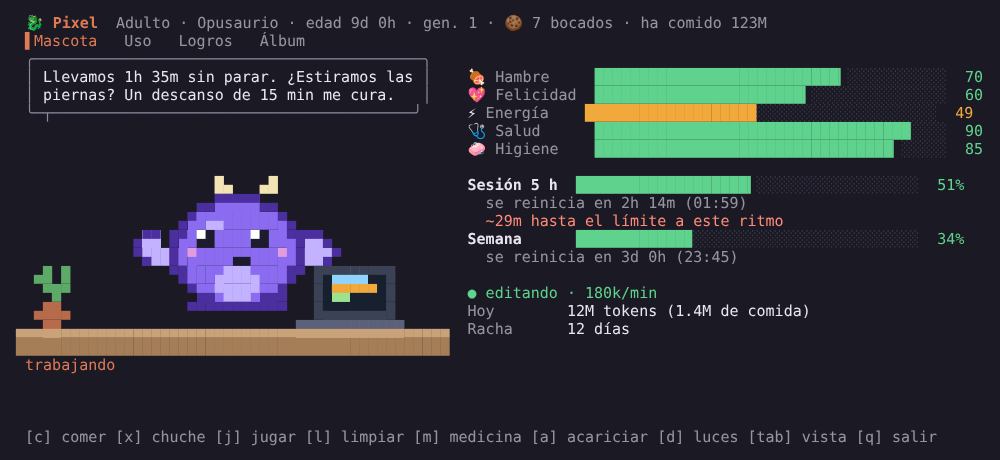

# Claudagotchi

Una mascota tipo tamagotchi que vive en tu terminal y en la barra de estado de Claude Code, y que **se alimenta de tu uso real de Claude**. Cuanto más programas, más come y más crece. Si te pasas, se quema. Si llegas al límite de la sesión, se duerme hasta que se reinicia. Y si llevas horas sin parar, te pide que descanses (y se cura cuando lo haces).



```bash
npx github:CarlosDarko/claudagotchi
```

## Qué es

Mezcla dos cosas que ya existían por separado:

- **Un monitor de uso de Claude Code**: el % real de tu sesión de 5 horas y de tu semana, cuándo se reinician, a qué ritmo gastas y si llegarás al reinicio, tokens por día, modelo y proyecto, y un mapa de 30 días.
- **Un tamagotchi de verdad**: con hambre, felicidad, energía, salud e higiene, cacas que limpiar, enfermedades, evolución en seis etapas, cinco formas adultas, logros, minijuego y, si lo descuidas, una nube a la que se va.

La gracia está en que las dos cosas están conectadas: tus tokens son su comida, el % de tu sesión es su energía y tus descansos son su salud.

## Cómo se instala

Necesitas [Node](https://nodejs.org) 18 o superior y [Claude Code](https://claude.com/claude-code). No tiene dependencias.

```bash
npx github:CarlosDarko/claudagotchi
```

O clonado:

```bash
git clone https://github.com/CarlosDarko/claudagotchi.git
```

```bash
cd claudagotchi && npm link
```

Para tenerla siempre a la vista dentro de Claude Code, ponla en la statusline:

```bash
claudagotchi instalar
```

Si ya tenías otra statusline, se guarda y `claudagotchi desinstalar` la devuelve tal cual.

## Comandos

| Comando | Qué hace |
|---|---|
| `claudagotchi` | Abre la mascota (interfaz animada a pantalla completa) |
| `claudagotchi instalar` | La pone en la statusline de Claude Code |
| `claudagotchi desinstalar` | La quita y devuelve la statusline que tuvieras |
| `claudagotchi estado` | Resumen en una línea, el mismo de la statusline |
| `claudagotchi nombre Turrón` | Le cambia el nombre |
| `claudagotchi nuevo [nombre]` | Adopta un huevo nuevo (la actual se jubila al álbum) |
| `claudagotchi idioma es` | Cambia el idioma |
| `claudagotchi demo` | Pasea por todas las etapas y humores sin esperar semanas |
| `claudagotchi foto [ancho] [alto]` | Imprime un fotograma de la interfaz (útil para compartir) |

### Teclas

| Tecla | Acción |
|---|---|
| `c` | Comer (gasta 1 bocado, +25 de saciedad) |
| `x` | Chuche (gasta 1 bocado, mucha felicidad, algo de salud) |
| `j` | Jugar: adivina con ← → hacia dónde mirará, 5 rondas |
| `l` | Limpiar las cacas |
| `m` | Medicina (cura, con 2 horas de espera entre tomas) |
| `a` | Acariciar |
| `d` | Apagar o encender la luz (dormido gasta la mitad) |
| `tab` o `1`–`4` | Mascota · Uso · Logros · Álbum |
| `h` | Adoptar un huevo nuevo cuando se ha ido a la nube |
| `q` | Salir |

## Cómo funciona el juego

| Necesidad | Baja con | Sube con |
|---|---|---|
| 🍖 **Hambre** | 4 puntos por hora | Tus tokens: cada 40k tokens nuevos es 1 punto. También los bocados |
| ⚡ **Energía** | Tu sesión de 5 h: es exactamente el reverso de tu % | El reinicio de la ventana. Sin cuenta, descansar |
| 💖 **Felicidad** | 2,5 por hora | Jugar, acariciar, chuches, programar con él al lado, días seguidos |
| 🧼 **Higiene** | Las cacas (una cada 1,5M tokens o cada 8 h despierto) | Limpiar |
| 🩺 **Salud** | Hambre o suciedad extremas, la semana por encima del 90 %, más de 2 h trabajando sin parar | Todo en orden, medicina, y los descansos después de un tramo largo |

- **Bocados**: la moneda para darle de comer a mano. Ganas 1 cada 150k tokens, 2 al día por saludar y empiezas con 5.
- **Humores**: feliz, tranquilo, trabajando (con su portátil), hambriento, sucio, triste, cansado, enfermo, en llamas (sesión al 90 %), durmiendo (luz apagada o sesión al 100 %) y en la nube.
- **Hiberna**: si nadie lo mira en más de 12 horas, deja de gastar. No se te muere un fin de semana.
- **En la nube**: si su salud llega a 0 se va. Queda en el **Álbum** y puedes adoptar otro huevo, que hereda tus logros.

### Evolución


| Etapa | Cuándo |
|---|---|
| 🥚 Huevo | Al empezar. Eclosiona en cuanto come algo y pasan unos minutos |
| 🐣 Bebé | Recién nacido |
| 🐥 Peque | 2M tokens y 12 horas de vida |
| 🐤 Adolescente | 15M tokens y 2 días |
| Adulto | 60M tokens y 5 días |
| 👑 Leyenda | 400M tokens, 3 semanas y un cuidado de diez |

La **forma adulta depende de su dieta**, es decir, del modelo con el que más programas:

| Forma | Dieta |
|---|---|
| 🐉 Opusaurio | Sobre todo Opus. Cuernos, alas y aire de jefe |
| 🐦 Sonetín | Sobre todo Sonnet. Cresta de pluma y notas musicales |
| 🐟 Haikoi | Sobre todo Haiku. Aletas y burbujas |
| 🧙 Fabulín | Sobre todo Fable. Sombrero de mago |
| 🦄 Quimerilla | Dieta variada. Un cuerno y una aleta |

Y la **variante depende de cómo lo hayas cuidado**: **brillante** si casi siempre estuvo bien atendido, **gruñón** si no, normal en medio.

### Lo que dice

Habla solo cuando pasa algo: cuando nace o evoluciona, al saludarte cada día (con lo que comió ayer y vuestra racha), cuando se acerca o llega al límite, cuando la ventana se reinicia, cuando tiene hambre o está sucio o enfermo, cuando llevas 90 minutos seguidos (y te da las gracias cuando descansas) y cuando ganas un logro. En la statusline aparece como una segunda línea durante un minuto y medio.


## El uso real


| Dato | De dónde sale |
|---|---|
| % de la sesión de 5 h y de la semana, y cuándo se reinician | De tu cuenta de Claude: primero del campo `rate_limits` que Claude Code pasa a la statusline, y si no, de la API de uso con el login que Claude Code ya tiene guardado |
| Tokens, comida, modelos, proyectos, horas y mapa de 30 días | De los logs locales de Claude Code, `~/.claude/projects/**/*.jsonl`, leídos de forma incremental |
| Si está trabajando y en qué (leyendo, editando, ejecutando…) | De la última actividad y la última herramienta en esos logs |
| Proyección (`~35m hasta el límite a este ritmo`) | Del ritmo de tokens de los últimos 20 minutos, convertido a % con la proporción de tu sesión |

- **Tokens** cuenta todo, incluida la caché. **Comida** cuenta solo los tokens nuevos (entrada, salida y escritura de caché): la lectura de caché es casi gratis y no alimenta.
- **No pide login propio** ni guarda tu token: usa el que Claude Code ya tiene (en `~/.claude/.credentials.json`, o en el Llavero en macOS). Sin él, todo funciona salvo el %.
- **Una lectura vieja nunca se convierte en 0 %**: si la ventana ya pasó y no hay dato nuevo, lo dice.

## Qué mejora respecto a la idea original

Está inspirado en [Clauddy](https://github.com/renatoaug/claude-usage-monitor), un monitor de uso con una mascota que reacciona. Claudagotchi lleva la idea más lejos:

| | Clauddy | Claudagotchi |
|---|---|---|
| La mascota | Reacciona a tu uso | **Vive de tu uso**: necesidades, evolución, enfermedades, muerte y álbum |
| Dónde vive | App de escritorio flotante | En la terminal y **dentro de Claude Code**, en su statusline, donde ya estás |
| Instalación | App nativa de 20 MB por plataforma | Un comando de Node, sin dependencias, en macOS, Linux y Windows |
| Login | Su propio OAuth | **Ninguno**: reutiliza el de Claude Code o el `rate_limits` de la statusline |
| Tu salud | Te sugiere estirar | Los descansos **curan** a la mascota y trabajar sin parar la enferma |
| Progreso | — | Logros, rachas, 6 etapas, 5 formas según tu modelo y variantes según tu cuidado |
| Idiomas | Inglés | Castellano, preparado para cualquier idioma |

## Idiomas

La mascota habla en castellano. Todos los textos están en [`src/i18n/es.js`](src/i18n/es.js). Para añadir otro idioma:

1. Copia `src/i18n/es.js` como `src/i18n/en.js` (o el código que sea) y traduce los valores. Las claves no se tocan, las `{variables}` se mantienen y las listas pueden tener las frases que quieras.
2. Regístralo en `LOCALES` dentro de [`src/i18n/index.js`](src/i18n/index.js).
3. Elígelo con `claudagotchi idioma en` o con la variable `CLAUDAGOTCHI_LANG=en`.

Una clave que falte en la traducción cae al castellano, así que se puede traducir poco a poco.

## Privacidad

Todo se queda en tu máquina, en `~/.claudagotchi/`:

| Fichero | Guarda |
|---|---|
| `pet.json` | Tu mascota: necesidades, historia, logros y álbum |
| `usage-index.json` | El resumen de tus logs por día (60 días) y por dónde se quedó leyendo cada fichero |
| `limits-cache.json` | La última lectura de tu % |
| `config.json` | Idioma y la statusline anterior, si la había |

Lo único que sale de tu máquina es la consulta del % a `api.anthropic.com`, como mucho una vez cada 3 minutos y solo si Claude Code no te lo da ya.

## Desarrollo

```bash
npm test
```

```bash
node bin/claudagotchi.js demo
```

```bash
tools/screenshots.sh
```

El primero pasa los tests (`node:test`, sin dependencias). El segundo abre la demo. El tercero regenera las capturas de `docs/img` (necesita Playwright). Cómo está hecho por dentro: [`docs/arquitectura.md`](docs/arquitectura.md).

## Licencia

MIT.
