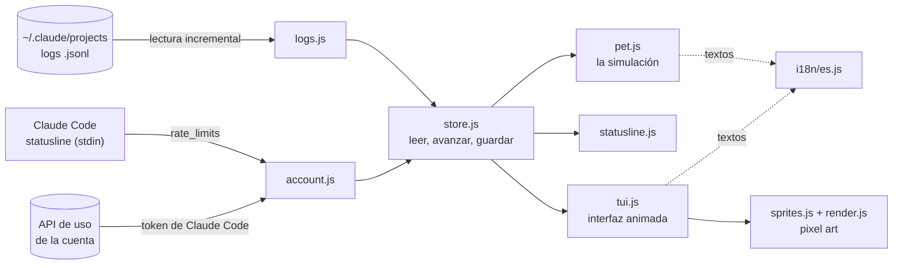

# Arquitectura

Cómo está hecho Claudagotchi por dentro. Node 18+, sin dependencias.

## Las piezas

| Fichero | Qué hace |
|---|---|
| `src/logs.js` | Lee los `.jsonl` de Claude Code desde donde se quedó (guarda el desplazamiento de cada fichero), ignora líneas a medio escribir y duplicados, y resume por día: tokens, comida, modelos, proyectos y horas |
| `src/account.js` | El % real: `rate_limits` de la statusline, caché de 3 min o la API de uso con el token de Claude Code. Si falla, espera 5 min antes de reintentar |
| `src/pet.js` | La simulación, pura: `tick(estado, { index, limits, now })` avanza en pasos de 15 min, `act()` aplica las acciones, `mood()` decide el humor. Todas las reglas numéricas están juntas en `RULES` |
| `src/store.js` | Leer, modificar y guardar de golpe, con escritura atómica, porque la statusline y la interfaz pueden tocar la mascota a la vez |
| `src/sprites.js` | El pixel art dibujado en código: cuerpo por etapa, ojos y boca por humor, accesorios por forma, y la escena (suelo, planta, cacas, noche, llamas, portátil) |
| `src/render.js` | Del lienzo a la terminal con medios bloques (`▀▄`) para píxeles cuadrados, en color de 24 bits o de 256. También a SVG para la documentación |
| `src/tui.js` | La interfaz: `renderFrame()` es una función pura que devuelve el fotograma, y `startTui()` lo anima a ~4,5 fps y relee los datos cada 5 s |
| `src/statusline.js` | La línea (y el bocadillo) de la statusline de Claude Code |
| `src/i18n/` | Todos los textos. Ver 'Idiomas' en el README |
| `src/demo.js` | Escenas de mentira para `claudagotchi demo`, los tests y las capturas |

## Decisiones

- **Sin login propio.** Claude Code ya está autenticado y ya pasa el `rate_limits` a la statusline. Pedir otro OAuth era duplicar algo delicado.
- **Comida sin caché.** La lectura de caché multiplica los tokens por 10 o más y casi no cuesta. Si alimentara, cualquier sesión larga empacharía a la mascota.
- **Hibernación a las 12 h.** Un tamagotchi que se muere porque cerraste el portátil el viernes no es divertido, es una alarma.
- **La energía es tu sesión.** Así la mascota enseña de un vistazo lo que el monitor enseña con números.
- **Los descansos curan.** La mejor forma de que alguien descanse es que su mascota lo agradezca.
- **Todo puro y con `now` inyectado.** La simulación se prueba sin relojes ni ficheros (`test/pet.test.js`).

## Datos en disco

En `~/.claudagotchi/` (o en `CLAUDAGOTCHI_HOME`). La carpeta de Claude Code se puede cambiar con `CLAUDE_CONFIG_DIR`.

## Variables de entorno

| Variable | Para qué |
|---|---|
| `CLAUDAGOTCHI_LANG` | Idioma |
| `CLAUDAGOTCHI_HOME` | Dónde guarda sus datos |
| `CLAUDAGOTCHI_TRUECOLOR=1` | Fuerza color de 24 bits si tu terminal lo admite y no lo anuncia |
| `NO_COLOR` | Sin colores |
| `CLAUDE_CONFIG_DIR` | La carpeta de Claude Code, si no es `~/.claude` |
